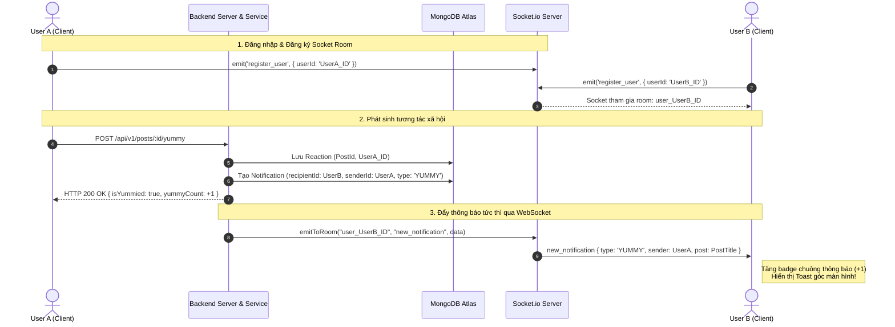

# ⚡ THIẾT KẾ LUỒNG REALTIME (SOCKET.IO EVENTS)

> **Mã tài liệu:** `ARCH-RT-01`  
> **Dự án:** HUST-Food  
> **Công nghệ:** Socket.io (Client & Server)  
> **Mục tiêu:** Cung cấp trải nghiệm thông báo đẩy tức thì (F21) khi có tương tác xã hội.

---

## 1. Cơ chế Quản lý Phòng (Room Management)

Mỗi người dùng sau khi đăng nhập thành công sẽ được gán vào một **Private Room** duy nhất trên Socket Server dựa trên `userId` của họ:

$$\text{Room ID} = \texttt{user\_\{userId\}}$$

Điều này giúp Server có thể gửi thông báo đích danh tới người dùng cụ thể mà không làm ảnh hưởng tới các kết nối khác (tránh phát tán broadcast không cần thiết).

---

## 2. Danh mục Sự kiện WebSocket (Socket.io Events)

| Tên sự kiện (Event) | Chiều giao tiếp | Payload dữ liệu | Mô tả kỹ thuật |
| :--- | :--- | :--- | :--- |
| **`register_user`** | Client $\rightarrow$ Server | `{ userId: string }` | Client phát sự kiện ngay khi người dùng đăng nhập hoặc khi mở app nếu đã có token. Server tiếp nhận và đưa socket vào Room `user_${userId}`. |
| **`new_notification`** | Server $\rightarrow$ Client | `{ _id: string, type: 'YUMMY' \| 'COMMENT' \| 'REPLY' \| 'FOLLOW', sender: { _id, username, fullName, avatarUrl }, post?: { _id, title }, createdAt: string }` | Khi User A thực hiện tương tác với User B (Thả Yummy, Bình luận, Follow), Server lưu Notification vào DB xong sẽ lập tức `emit` sự kiện này tới Room `user_${userB_Id}`. |

---

## 3. Sơ đồ Luồng Tương tác Realtime (Sequence Diagram)

Ví dụ luồng khi **User A thả cảm xúc Yummy vào bài viết của User B**:

---

## 4. Xử lý Trạng thái Ngoại lệ & Tái kết nối (Reconnection)

1. **Client Disconnect:** Khi người dùng đóng tab hoặc mất mạng, Socket tự động ngắt kết nối. Khi có mạng trở lại, Socket.io Client tự động reconnect và gửi lại sự kiện `register_user`.
2. **Không bỏ lỡ thông báo khi Offline:** Nếu User B đang offline (chưa kết nối Socket), thông báo vẫn được lưu an toàn trong bảng `notifications` của MongoDB. Khi User B đăng nhập lại, API `GET /api/v1/notifications` sẽ trả về đầy đủ danh sách thông báo chưa đọc.

