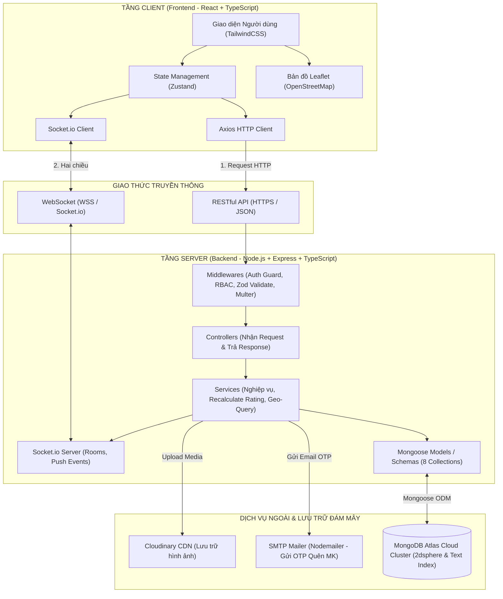

# 🏛️ THIẾT KẾ KIẾN TRÚC HỆ THỐNG (SYSTEM ARCHITECTURE)

> **Mã tài liệu:** `ARCH-SYS-01`  
> **Dự án:** HUST-Food  
> **Mô hình kiến trúc:** Decoupled Monorepo (Client & Server độc lập)  
> **Nền tảng:** TypeScript Fullstack

---

## 1. Sơ đồ Kiến trúc Tổng thể (High-Level Architecture)

---

## 2. Chi tiết Lựa chọn Công nghệ (Tech Stack)

| Tầng công nghệ | Công nghệ lựa chọn | Lý do chọn & Vai trò trong HUST-Food |
| :--- | :--- | :--- |
| **Ngôn ngữ chung** | **TypeScript (.ts / .tsx)** | Đảm bảo tính nhất quán kiểu dữ liệu giữa Client (`src/types/`) và Server (`Models/DTOs`), loại bỏ 90% lỗi sai tên trường khi nhóm 4 người phát triển song song. |
| **Frontend Client** | **React (Vite), TailwindCSS, Zustand, React Hook Form + Zod, Axios** | Khởi tạo siêu tốc với Vite; TailwindCSS viết style trực quan; Zustand quản lý global state gọn gàng không boilerplate; Zod validate form đa bước chặt chẽ. |
| **Bản đồ số** | **React-Leaflet + OpenStreetMap** | Hoàn toàn miễn phí, không yêu cầu thẻ tín dụng (so với Google Maps API), hỗ trợ tùy biến icon Marker quán ăn, vẽ vòng tròn bán kính và popup tương tác tốt. |
| **Backend Server** | **Node.js, Express.js, Socket.io, Multer, Cloudinary SDK, Nodemailer** | Xử lý bất đồng bộ I/O cao, tích hợp mượt mà với WebSocket cho thông báo đẩy thời gian thực, quản lý upload ảnh đa tệp và gửi email khôi phục mật khẩu. |
| **Cơ sở dữ liệu** | **MongoDB (Mongoose ODM)** | Hỗ trợ chỉ mục không gian `2dsphere` cho truy vấn tọa độ quán ăn `$geoNear`, cấu trúc document linh hoạt để lưu trữ danh sách món ăn trong Menu và các bước nấu ăn. |
| **Hạ tầng & Triển khai** | **AWS, MongoDB Atlas (Cloud Database)** | Lưu trữ CSDL tập trung trên Atlas, ứng dụng web có thể chạy trên môi trường điện toán đám mây ổn định. |

---

## 3. Luồng Kiến trúc 3 Lớp Phía Server (Layered Architecture)

Server được xây dựng theo mô hình phân lớp nghiêm ngặt nhằm tách biệt mối quan tâm (Separation of Concerns):

$$\text{Client Request} \longrightarrow \textbf{Routes} \longrightarrow \textbf{Middlewares} \longrightarrow \textbf{Controllers} \longrightarrow \textbf{Services} \longrightarrow \textbf{Models} \longrightarrow \text{Response JSON}$$

1. **Routes (`routes/*.route.ts`):** Khai báo URL endpoint, phương thức HTTP (GET, POST, PUT, PATCH, DELETE) và gắn các middleware tương ứng.
2. **Middlewares (`middlewares/*.middleware.ts`):**
   * `auth.middleware.ts`: Giải mã JWT token, kiểm tra trạng thái tài khoản không bị `BANNED`.
   * `role.middleware.ts`: Kiểm tra quyền Quản trị viên (`role === 'ADMIN'`).
   * `validate.middleware.ts`: Dùng Zod schema kiểm tra dữ liệu `body`, `query`, `params`.
   * `upload.middleware.ts`: Multer lọc định dạng file ảnh và kiểm tra dung lượng $\le 5\text{MB}$.
3. **Controllers (`controllers/*.controller.ts`):** Tiếp nhận dữ liệu từ `req`, chuyển giao xử lý cho tầng Service, đóng gói dữ liệu và gọi helper `apiResponse` trả về cho Client. Tuyệt đối **không viết logic tính toán hay truy vấn DB trực tiếp trong Controller**.
4. **Services (`services/*.service.ts`):** Chứa **100% logic nghiệp vụ**:
   * Tính toán điểm sao trung bình quán ăn sau mỗi review (`recalculatePlaceRatings`).
   * Truy vấn không gian địa lý `$geoNear`.
   * Phát thông báo WebSocket tới Socket.io Server.
5. **Models (`models/*.ts`):** Định nghĩa Mongoose Schemas, Typescript Interfaces, chỉ mục (Indexes) và middleware vòng đời (`pre-save`).

