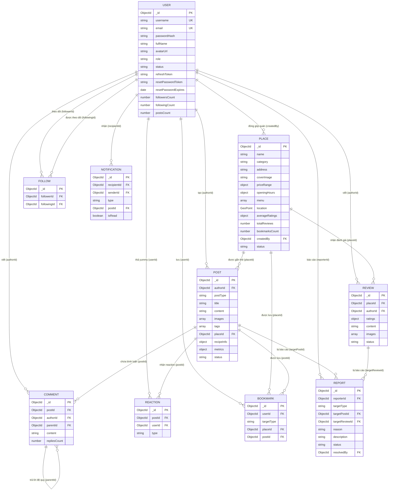

# 📊 SƠ ĐỒ QUAN HỆ THỰC THỂ (ERD DIAGRAM)

> **Mã tài liệu:** `DB-ERD-01`  
> **Dự án:** HUST-Food  
> **Công cụ hiển thị:** Mermaid ER Diagram

---

## 1. Sơ đồ Quan hệ Thực thể (Entity-Relationship Diagram)

---

## 2. Diễn giải các mối quan hệ chính
1. **User $\leftrightarrow$ Place $\leftrightarrow$ Review:**
   * Một `User` có thể tạo nhiều `Place` (đóng góp quán mới).
   * Một `Place` nhận nhiều `Review` từ cộng đồng.
   * Ràng buộc duy nhất: Một cặp `(placeId, authorId)` trong bảng `Review` chỉ được tồn tại **1 lần** duy nhất.
2. **Post $\leftrightarrow$ Place:**
   * Mối quan hệ lỏng (Optional Ref): Bài viết chia sẻ trải nghiệm (`postType: 'EXPERIENCE'`) có thể gắn kèm `placeId` để trỏ tới Quán ăn tương ứng hoặc để trống (`null`).
3. **Comment đệ quy (Parent-Child):**
   * Trường `parentId` trong `Comment` trỏ về chính `_id` của một `Comment` khác (nếu là câu trả lời / Reply). Nếu là bình luận gốc cấp 1 thì `parentId = null`.
4. **Bookmark đa hình (Polymorphic Bookmark):**
   * Trường `targetType` nhận giá trị `'PLACE'` hoặc `'POST'`, kết hợp với `placeId` hoặc `postId` tương ứng.

