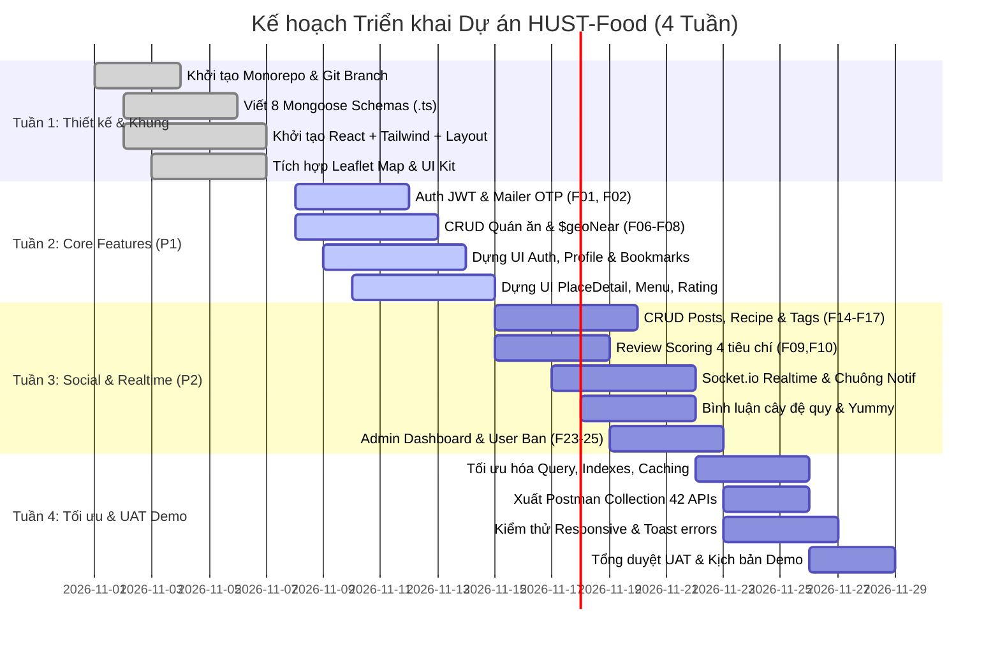

# 📅 KẾ HOẠCH TIẾN ĐỘ TRIỂN KHAI (SPRINT ROADMAP)

> **Mã tài liệu:** `PM-PLAN-01`  
> **Dự án:** HUST-Food  
> **Tổng thời gian:** 4 Tuần (Sprints)  
> **Quy mô:** 4 thành viên phát triển toàn thời gian

---

## 1. Ma trận Kế hoạch Tiến độ 4 Tuần

---

## 2. Chi tiết Công việc Từng Tuần theo Thành viên

### 📍 TUẦN 1: THIẾT KẾ & DỰNG KHUNG DỰ ÁN
* **Vương (BE 1):** Khởi tạo cấu trúc dự án chuẩn Monorepo; thiết lập quy tắc bảo vệ nhánh Git; code đầy đủ 8 Mongoose Schemas (.ts) kèm bộ chỉ mục (Indexes); tích hợp Multer và Cloudinary Upload SDK.
* **Dũng (BE 2):** Khởi tạo Cluster MongoDB Atlas Cloud; thiết lập kết nối; viết file `utils/seedData.ts` chứa 20 địa điểm quán ăn mẫu có tọa độ GPS thật quanh khu vực Bách Khoa Hà Nội.
* **Tuấn (FE 1):** Khởi tạo dự án React + TypeScript với Vite; cấu hình TailwindCSS; cấu hình Axios Interceptors tự động gán Bearer Token; dựng khung Layout 3 cột (`Navbar`, `Sidebar`, `RightTrendingTags`).
* **Vũ (FE 2):** Cài đặt và tích hợp `react-leaflet` hiển thị bản đồ số OpenStreetMap; xây dựng bộ UI Kit phản hồi (`Toast.tsx`, `Modal.tsx`, `StarRating.tsx`, `Skeleton.tsx`).

---

### 📍 TUẦN 2: TRIỂN KHAI PHÂN HỆ NỀN TẢNG (AUTH, PLACES & PROFILES)
* **Vương (BE 1):** Code 14 APIs Cụm 1: Đăng ký, đăng nhập JWT, làm mới token, cấu hình `Nodemailer` gửi OTP khôi phục mật khẩu (F01, F02); API Quản lý hồ sơ cá nhân, Follow và Bookmarks (F03 – F05).
* **Dũng (BE 2):** Code 6 APIs CRUD Quán ăn (F06 – F08); viết truy vấn không gian địa lý `$geoNear` quét quán ăn theo bán kính tọa độ trên bản đồ (F11 – F13).
* **Tuấn (FE 1):** Ghép giao diện `features/auth/` (Login, Register, Forgot Password); ghép giao diện `features/profiles/` (Xem trang cá nhân, sửa bio/avatar, xem danh sách Bookmarks).
* **Vũ (FE 2):** Ghép giao diện `features/places/` (Danh sách quán ăn có bộ lọc, trang Chi tiết quán ăn `PlaceDetail.tsx` hiển thị thực đơn và giờ mở cửa); tích hợp bản đồ với thanh trượt bán kính (Radius Slider).

---

### 📍 TUẦN 3: TƯƠNG TÁC MẠNG XÃ HỘI, BẢNG TIN & SOCKET REALTIME
* **Vương (BE 1):** Code 10 APIs Cụm 2: Upload ảnh Cloudinary; API Bảng tin Feed phân trang Cursor; API CRUD Bài viết chia sẻ trải nghiệm & Công thức nấu ăn (F14 – F17); API Thả Yummy & Bình luận đa cấp (F18, F19).
* **Dũng (BE 2):** Code 4 APIs Đánh giá 4 tiêu chí (F09, F10) kèm service `recalculatePlaceRatings`; dựng Socket.io Server đẩy thông báo tức thì (F21); code 8 APIs Báo cáo vi phạm và Quản trị Admin (F22 – F25).
* **Tuấn (FE 1):** Ghép giao diện `features/posts/`: Newsfeed cuộn vô tận có tab lọc; Form tạo bài viết/công thức có thêm nguyên liệu động; hiển thị cây bình luận đệ quy (`CommentSection.tsx`).
* **Vũ (FE 2):** Ghép Form chấm điểm 4 tiêu chí đánh giá quán ăn; ghép Socket.io Client nhận sự kiện nhảy badge chuông thông báo; dựng trang Quản trị Admin (`/admin`).

---

### 📍 TUẦN 4: TỐI ƯU HÓA, KIỂM THỬ UAT & DEMO
* **Vương (BE 1):** Tối ưu hóa hiệu năng truy vấn DB; kiểm tra bảo mật (chặn tài khoản BANNED ở middleware); xuất tài liệu Postman Collection 42 APIs đầy đủ vào `docs/`.
* **Dũng (BE 2):** Cấu hình Rate Limiting chống spam; kiểm tra kết nối WebSocket trên server Cloud; giám sát log server.
* **Tuấn (FE 1):** Chuẩn hóa trạng thái Loading Skeleton toàn bộ các trang; kiểm tra xử lý lỗi form và hiển thị Toast; điều phối buổi test tổng duyệt UAT của cả nhóm.
* **Vũ (FE 2):** Kiểm thử giao diện đáp ứng (Mobile / Tablet Responsive); kiểm tra trải nghiệm ghim vị trí bản đồ trên điện thoại; chuẩn bị kịch bản dữ liệu demo sản phẩm.

